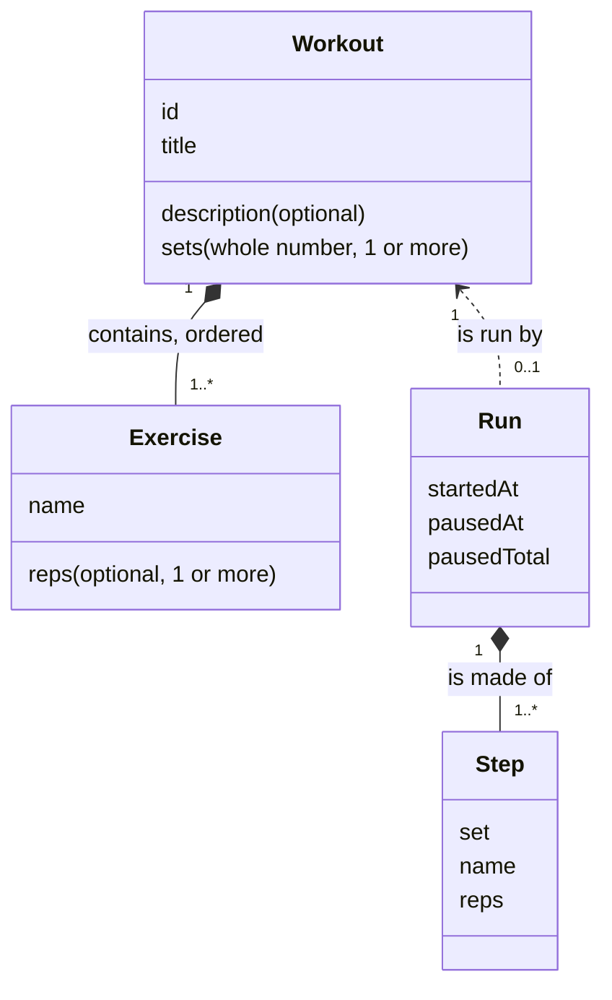
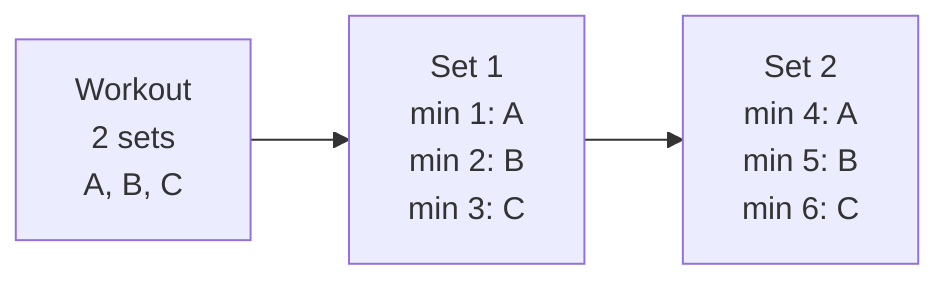
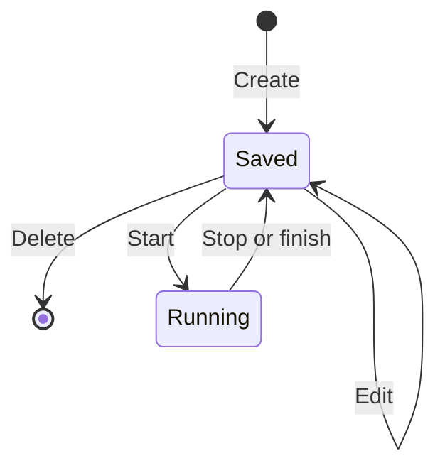
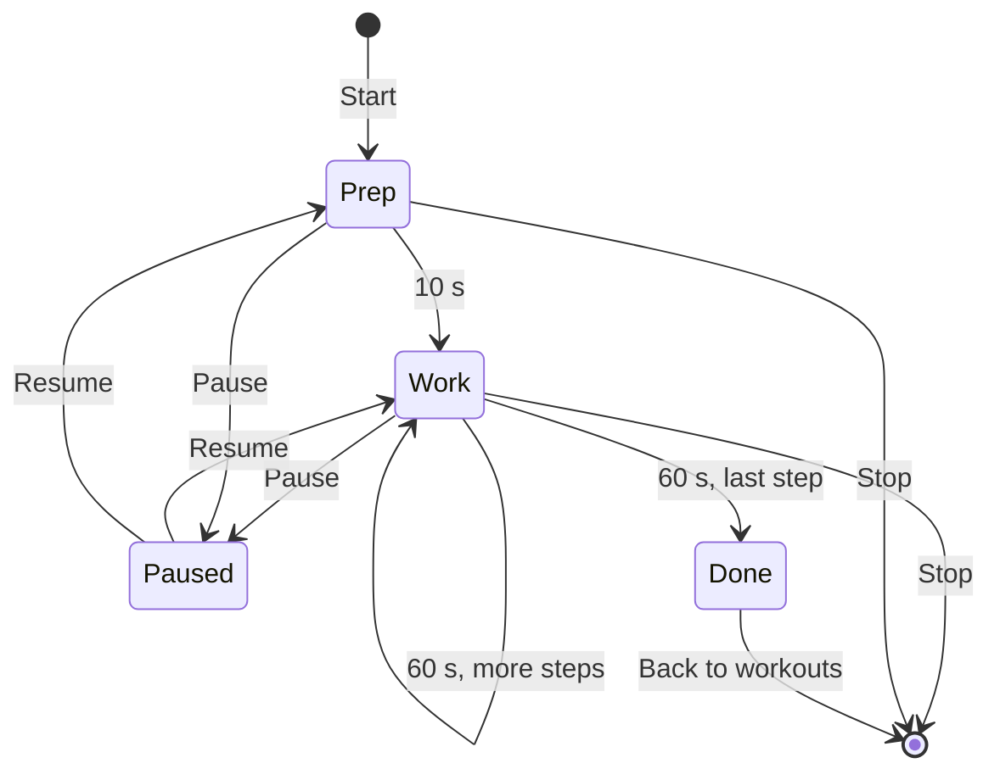
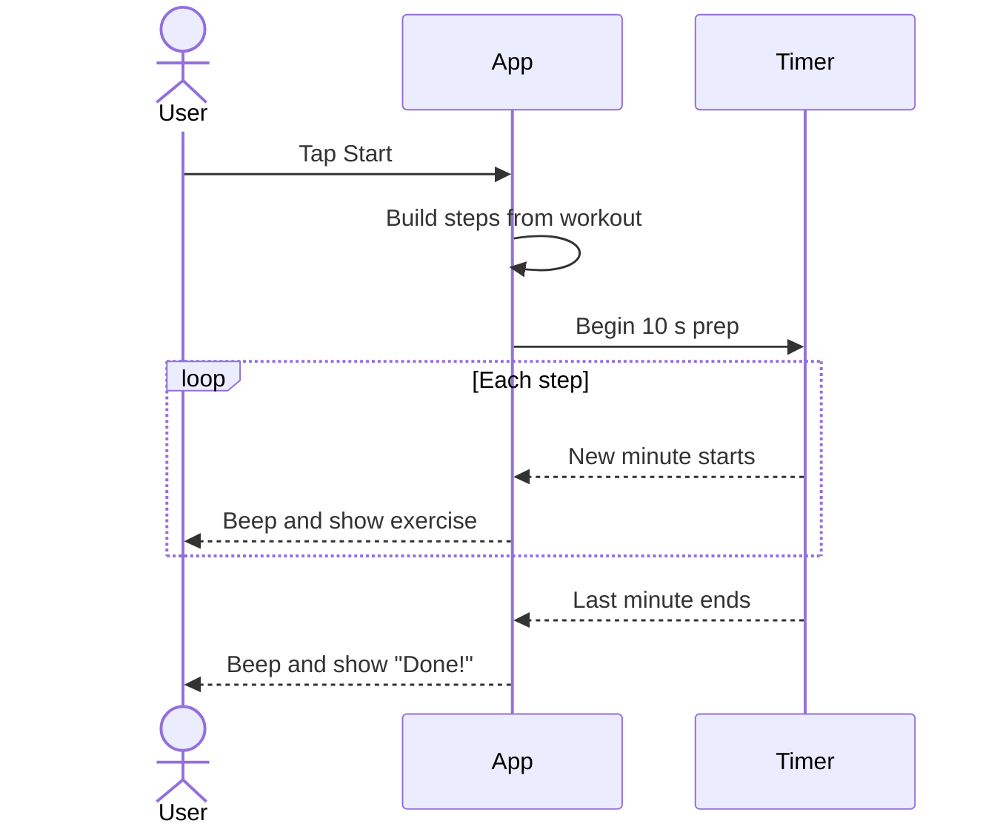

# Domain

This document describes the core entities of No Gym and the actions a user can do with them.

## Terms

| Term | Meaning |
|------|---------|
| **Workout** | A saved plan. It has a title, an optional description, a number of sets, and a list of exercises. |
| **Exercise** | One entry in a workout. It has a name and an optional rep count. |
| **Reps** | The number of repetitions. An exercise with no reps is not counted (for example, `REST`). |
| **Set** | One full pass through the list of exercises. |
| **Step** | One minute of work. One step is one exercise in one set. |
| **Run** | One live execution of a workout, with a timer. |
| **EMOM** | "Every minute on the minute". Each minute starts one new exercise. |

## Entities

A workout contains an ordered list of exercises. The order of the list is the order of the minutes.



### Workout rules

- A workout must have a title.
- `sets` must be a whole number of 1 or more. The default is 3.
- A workout must have at least one exercise.
- A rep count must be blank or a whole number of 1 or more. The default is 10.
- Workouts are saved in the browser local storage. They stay on the device.

### Run rules

A run is temporary. It is not saved. The app builds the steps from the workout:

`number of steps = sets × number of exercises`

`total time = number of steps` minutes (plus 10 seconds of preparation)

Example: a workout with 3 exercises and 2 sets has 6 steps. The run lasts 6 minutes.



## Actions

| Action | Where | Result |
|--------|-------|--------|
| Create a workout | List → **New workout** | The app saves a new workout. |
| Edit a workout | Card → **Edit** | The app replaces the saved workout. |
| Delete a workout | Editor → **Delete** (tap two times) | The app removes the workout. |
| Paste exercises | Editor → text area | The app reads one exercise for each line. |
| Copy exercises as text | Editor → **Copy exercises as text** | The app copies the exercises in the paste format. |
| Start a run | Card → **Start** | The timer begins with a preparation period. |
| Pause or resume | Run screen | The timer stops or continues. |
| Stop a run | Run screen → **Stop** (tap two times) | The run ends. The app goes back to the list. |

### Paste format

Write one exercise for each line. A leading number is the reps. The prefix `Min N:` is optional and the app ignores it. The order of the lines sets the order of the minutes.

```text
Min 1: 10 Deadlifts
Min 2: 10 Sit-Ups
Min 3: REST
```

| Line | Name | Reps |
|------|------|------|
| `Min 1: 10 Deadlifts` | Deadlifts | 10 |
| `Min 3: REST` | REST | none |

### Workout lifecycle



## Run

A run has these phases:

1. **Prep**: 10 seconds. The screen shows "Get ready".
2. **Work**: one 60-second period for each step. The screen shows the current exercise and the next exercise.
3. **Done**: the app shows "Done!".



### Run sequence



### Cues

| Event | Cue |
|-------|-----|
| A new minute starts | Long beep and vibration |
| Last 3 seconds of a period | Short beep each second |
| The workout ends | Long beep and vibration |

The app keeps the screen on during a run. When the user leaves the run screen, the run ends.

The app finds the position from the clock time, not from a counter. A slow timer cannot make the clock drift.
