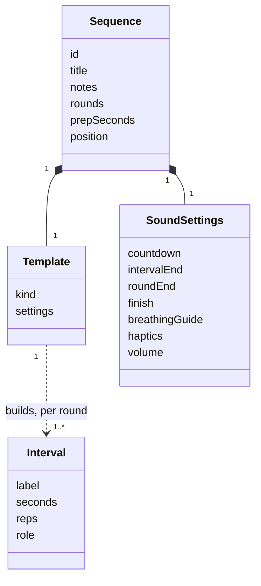
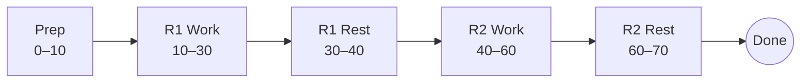
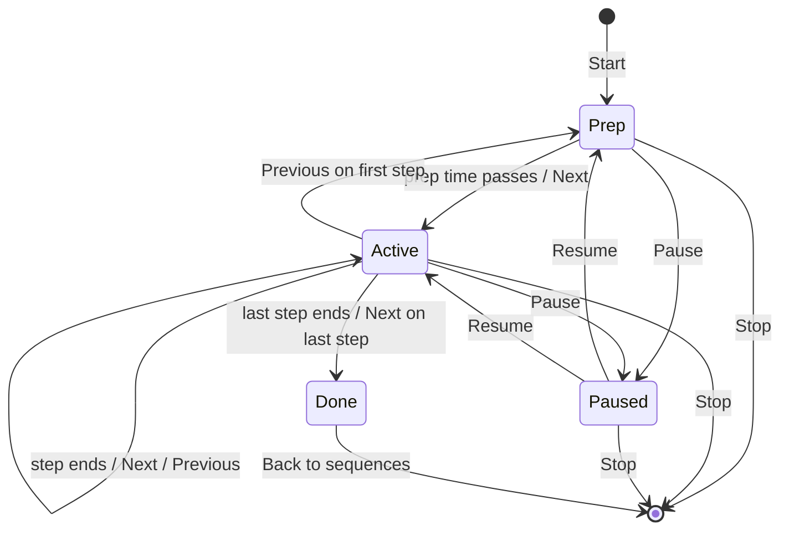

# No Gym: behaviour specification

This document describes **what the app does**, without assuming any technology. It is the reference for building No Gym on any platform. A web version could use Rails, Stimulus and Turbo, for example.

> **Source.** This spec was written from the iOS app in `ios/`. Its rules live in `ios/NoGymKit`, and its tests are the acceptance examples in [section 13](#13-acceptance-examples). When this spec and that code disagree, fix one of them so they match again.

The words **must**, **should** and **may** have their usual meaning. Text marked *(note)* explains something; it adds no rule.

---

## 1. Purpose and scope

No Gym is a timer for **sequences of timed intervals**. A sequence is a list of intervals, and each interval has a label and a duration. The whole list repeats for a number of **rounds**. With that one model, the app covers:

- EMOM training (every minute on the minute),
- Tabata and other work/rest protocols,
- breathing exercises (box breathing, 4-7-8, and others),
- yoga and stretching flows, and anything custom.

The run screen is like a kitchen or clock timer, but it puts the **current label** first and the **next label** second. The user can pause, skip and stop. Each sequence has its own sounds: countdown ticks, end-of-interval, end-of-round and finish sounds, and breathing guide tones.

**In scope:** one user on one device, creating, editing, deleting and reordering sequences, and running them.

**Out of scope for now:** accounts, sharing, sync between devices, voice announcements, history and statistics.

---

## 2. Glossary

| Term | Meaning |
|------|---------|
| **Sequence** | A saved plan: a title, notes, a template, rounds, prep time and sound settings. |
| **Template** | The kind of sequence and its own settings: **EMOM**, **Tabata**, **Breathing** or **Custom**. The app builds the intervals from it. |
| **Interval** | One timed entry: a label, a duration in seconds, optional reps, and a role. |
| **Reps** | An optional repetition count shown with the label, for example "10 × Burpees". |
| **Role** | What an interval is for: `work`, `rest`, `inhale`, `hold` or `exhale`. It picks the colour and the breathing tone. |
| **Round** | One pass through the intervals. (It is called a "set" in the old web prototype.) |
| **Prep** | The "Get ready" period before the first interval. It is not part of any round. |
| **Step** | One interval in one round, placed on the time line. |
| **Period** | The prep, or one step. Countdown ticks and boundary sounds belong to periods. |
| **Run** | One live performance of a sequence. It is not saved. |
| **Boundary** | The moment a period ends: `go` (prep ends), `interval`, `round` (last step of a round ends) or `finish` (last step ends). |
| **Cue** | A sound at a set time in a run: a countdown tick, a boundary sound, or a breathing tone. |

---

## 3. Data model



### 3.1 Sequence

| Field | Type | Rule | Default |
|-------|------|------|---------|
| id | unique id | | generated |
| title | text | must not be blank after trimming | blank (with a placeholder; see 10.3) |
| notes | text | optional; trimmed on save | blank |
| template | Template | see 3.3 | the chosen kind's starter |
| rounds | whole number | 1–99 | depends on the kind (3.3) |
| prepSeconds | number | 0–60 in the editor; must be ≥ 0 | 10 |
| sound | SoundSettings | see 3.4 | depends on the kind (3.4) |
| position | order in the list | the user can change it | added at the end |

### 3.2 Interval

| Field | Type | Rule |
|-------|------|------|
| label | text | must not be blank |
| seconds | number, may have decimals (5.5) | ≥ 1 |
| reps | whole number or empty | empty, or ≥ 1 |
| role | `work` · `rest` · `inhale` · `hold` · `exhale` | default `work` |

**Display label:** `"<reps> × <label>"` when there are reps, otherwise just the label. For example, "10 × Deadlifts" or "REST".

### 3.3 Templates

The sequence stores the template's **own settings**, not only the intervals they produce. That way, the editor reopens the same form.

| Kind | Settings | Starter content | Default rounds |
|------|----------|-----------------|----------------|
| **EMOM** | `stepSeconds` (default 60), `exercises`: a list of name + optional reps | Burpees 10, Squats 15, Rest (no reps) | 3 |
| **Tabata** | `workSeconds` (20), `restSeconds` (10), `exercises`: a list of names, may be empty | work 20, rest 10, no names | 8 |
| **Breathing** | `inhale`, `holdIn`, `exhale`, `holdOut` (seconds) | Box 4-4-4-4 | 6 |
| **Custom** | `intervals`: a list of Interval | "Child's pose" 45 s work, "Switch" 5 s rest | 1 |

**Kind descriptions**, shown in the template picker:

| Kind | Description | Icon idea |
|------|-------------|-----------|
| EMOM | Every minute on the minute. Each minute starts a new exercise. | stopwatch |
| Tabata | Work and rest pairs, like 20 s on and 10 s off, for 8 rounds. | flame |
| Breathing | Inhale, hold and exhale with guide tones. Box, 4-7-8 and more. | wind |
| Custom | Any list of labels and durations. Good for yoga and stretching. | list |

**Breathing presets:**

| Name | Inhale | Hold | Exhale | Hold |
|------|--------|------|--------|------|
| Box 4-4-4-4 | 4 | 4 | 4 | 4 |
| Relax 4-7-8 | 4 | 7 | 8 | 0 |
| Coherent 5.5-5.5 | 5.5 | 0 | 5.5 | 0 |

### 3.4 Sound settings

| Field | Values | Meaning |
|-------|--------|---------|
| countdown | `off` · `last3` · `last5` | Short ticks in the last 3 or 5 seconds of every period. |
| intervalEnd | a sound choice | Plays when a period ends and the next one starts. |
| roundEnd | a sound choice | Plays when the last step of a round ends. |
| finish | a sound choice | Plays when the whole sequence is done. |
| breathingGuide | on / off | Plays a guide tone on inhale, hold and exhale steps. |
| haptics | on / off | Vibrates on each new step, where the device can. |
| volume | 0–1 | Master volume of all cues. |

**Sound choices:** `none`, `beep`, `double beep`, `bell`, `chime`, `wood block`. Section 9 describes how each one sounds.

**Defaults by kind:**

| Field | EMOM, Tabata | Breathing | Custom |
|-------|--------------|-----------|--------|
| countdown | last 3 | off | last 3 |
| intervalEnd | beep | none | chime |
| roundEnd | double beep | none | bell |
| finish | bell | bell | bell |
| breathingGuide | off | **on** | off |
| haptics | on | off | on |
| volume | 0.8 | 0.6 | 0.8 |

---

## 4. Template expansion

Each template produces the intervals of **one round**, given the round's index (starting at 0). Only Tabata changes from one round to the next.

**EMOM:** one interval for each exercise, in list order.
- label = the exercise name, reps = the exercise reps, seconds = `stepSeconds`.
- role = `rest` if the name is "rest" (in any letter case), otherwise `work`.

**Tabata:**
- Blank names are dropped after trimming. If no names are left, the work label is **"Work"**. Otherwise, the label is `names[roundIndex mod names.count]`.
- One round = a `work` interval (`workSeconds`), then a `rest` interval labelled **"Rest"** (`restSeconds`).
- When `restSeconds` is 0, the rest interval is left out.
- *Example:* names "Squats", blank, "Push-ups" over 4 rounds give Squats, Push-ups, Squats, Push-ups.

**Breathing:** the phases are, in order, Inhale (`inhale`, role inhale), Hold (`holdIn`, role hold), Exhale (`exhale`, role exhale) and Hold (`holdOut`, role hold).
- A phase of 0 seconds is left out. So 4-7-8 is Inhale, Hold, Exhale, and Coherent is Inhale, Exhale.

**Custom:** the list as written, and the same list every round.

---

## 5. Validation

Before saving, the app trims the title and notes. Then it checks the rules below in this order and shows the **first** message that applies. The interval rules are checked over **every step of every round**.

| # | Rule | Message |
|---|------|---------|
| 1 | The title is not blank. | Give the sequence a title. |
| 2 | rounds ≥ 1 | Rounds must be at least 1. |
| 3 | prepSeconds ≥ 0 | Prep time can't be negative. |
| 4 | There is at least one interval. | Add at least one interval. |
| 5 | Every label is non-blank after trimming. | Every interval needs a label. |
| 6 | Every interval's seconds ≥ 1. | Every interval must last at least 1 second. |
| 7 | Every rep count is empty or ≥ 1. | Reps must be blank or at least 1. |

The messages appear in a dialog titled **"Can't save yet"**. The sequence is not saved.

---

## 6. Timeline

A run is laid out in time like this: the **prep** first (if prepSeconds > 0), then every interval of round 1, then of round 2, and so on.

- Every step has `round` (starting at 1), `indexInRound` (starting at 0), its interval, a `start` and an `end`. Times are in seconds from the start of the run, prep included.
- **duration** is the end of the last step (or the prep length, if there are no steps).
- **workDuration** is duration − prep. This is the "total time" shown in lists and the editor.
- **stepsPerRound** is the largest number of intervals in any round.
- A step is **last in its round** if it is the last step overall, or if the next step belongs to a later round.

*Example:* prep 10, Tabata 20/10, 2 rounds. The steps start at 10, 30, 40 and 60, and the run ends at 70. Steps 1 and 3 (0-based) are last in their round.



---

## 7. Run clock

The position in a run **must** be worked out from timestamps, never by counting timer ticks. Then a late or skipped screen update can't make the timer drift.

The clock stores `startedAt`, `pausedAt` (empty while running), `pausedTotal` and `skipOffset`.

```
elapsed(now) = (pausedAt or now) − startedAt − pausedTotal + skipOffset
```

### 7.1 Position

The position at a moment, with `e = max(0, elapsed)`, is:

| Condition | Phase | Step index | Remaining | Length |
|-----------|-------|------------|-----------|--------|
| e < prep | `prep` | −1 | prep − e | prep |
| a step has start ≤ e < end | `active` | that step | end − e | the step's duration |
| e ≥ duration | `done` | step count | 0 | 0 |

- A boundary moment belongs to the **next** step. At e = 30 in the example above, the run is in step 1, not step 0.
- **fraction** = 1 − remaining / length, kept between 0 and 1 (1 when length is 0).
- **Displayed seconds** are the remaining seconds **rounded up**. With 4.2 s left, the screen shows 0:05.

### 7.2 Pause and resume

- **Pause:** if the clock is running, set `pausedAt = now`. If it is already paused, nothing changes: a second pause keeps the first pause time.
- **Resume:** if the clock is paused, add `now − pausedAt` to `pausedTotal` and clear `pausedAt`.

### 7.3 Skip

A skip works by **jumping**: to make elapsed equal a target, add `target − elapsed(now)` to `skipOffset`. A jump works the same way while paused, and the clock stays paused.

- **Next:** jump to the start of the next step. During prep, that is the first step. On the last step, it is `duration`, which ends the run.
- **Previous**, which works like a music player:
  - during prep: jump to 0;
  - if 2 seconds or more have passed in the current step, or the run is done: jump to the start of the current step (the last step, when done);
  - otherwise, jump to the start of the step before, or to 0 if this is the first step.



---

## 8. Cue schedule

The app works out **every cue of a run up front**, from the timeline and the sound settings. Each cue is a time (seconds from the run's start) and a kind. The list is sorted by time.

### 8.1 Periods

The periods are the prep (only if prep > 0 and there is at least one step) and every step. Each period has a boundary kind:

| Period | Boundary |
|--------|----------|
| prep | `go` |
| a step that is the last step overall | `finish` |
| a step that is last in its round | `round` |
| any other step | `interval` |

### 8.2 Countdown ticks

With N = 3 or 5 (none when the countdown is off), each period gets a tick at `end − k` for k = N, N−1, …, 1. A tick is only added if its time is **after** the period's start. A period never ticks at or before its own start.

*Example:* a 2 s step with "last 5" gets one tick, 1 s after the step starts.

### 8.3 Boundary sounds

At each period's end, play the most important sound that is not `none`:

| Boundary | Order to try |
|----------|--------------|
| go, interval | intervalEnd |
| round | roundEnd → intervalEnd |
| finish | finish → roundEnd → intervalEnd |

If every sound in the order is `none`, nothing plays.

### 8.4 Breathing tones

When breathingGuide is on, every step whose role is `inhale`, `hold` or `exhale` gets a breathing cue at its start. The cue carries the role and the step's duration.

### 8.5 Playback rules

- Cues **should** be scheduled ahead on the platform's audio clock, not fired by a UI timer. Then they play on time even while the UI is busy, throttled or in the background.
- **On start, resume or skip:** clear all pending cues, then schedule every cue whose time ≥ elapsed − 0.05 s, at `now + (cue time − elapsed)`. A breathing tone that has already started is not replayed partway.
- **On pause:** clear all pending cues.
- **After an audio interruption** (a phone call, a device change): restart audio and reschedule as on resume.
- Cue sounds may overlap each other. Breathing tones, ticks and boundary sounds should play on separate channels, so a long tone never delays a tick.
- Cues should **mix with** other audio the user is playing, such as music, and not stop it.

---

## 9. Sound design

All sounds are synthesised from sine waves, so the app needs no audio files. Each sound is mono, and samples range from −1 to 1.

**Building block, "tone":** a sum of sine partials (frequency, gain). The value at time t is

`0.8 × Σ(sin(2π·f·t)·gain) / Σgain × attack × exp(−decay·t) × release`

where attack and release are 5 ms linear ramps at the start and end, so a sound never clicks.

| Sound | Partials (Hz × gain) | Length | Decay | Notes |
|-------|----------------------|--------|-------|-------|
| beep | 990 × 1 | 0.5 s | 8 | |
| double beep | 880 × 1 | 0.15 s each | 10 | two copies, starting at 0 s and 0.25 s |
| bell | 660 × 1, 1821.6 × 0.4, 3564 × 0.15 | 1.8 s | 2.5 | the partials are 660 × 1, × 2.76 and × 5.4 |
| chime | 784 × 1 + 1568 × 0.2 (0.9 s), then 1047 × 1 + 2094 × 0.2 (1.0 s) | | 4 | the second note starts at 0.18 s |
| wood block | 1200 × 1, 2650 × 0.5 | 0.12 s | 45 | |
| countdown tick | 660 × 1 | 0.15 s | 12 | the same for every sequence |

Sounds made of several parts are mixed. If the mix peaks above 0.9, it is scaled down to a peak of 0.9.

**Breathing tones**, which last the whole phase:

| Role | Sound |
|------|-------|
| inhale | A "glide" from **220 Hz to 440 Hz** over the phase. |
| exhale | A glide from **440 Hz to 220 Hz**. |
| hold | A soft tone: 165 × 1 + 330 × 0.3, length min(phase, 0.8 s), decay 4, scaled × 0.6. |

**Glide:** the pitch moves along an eased curve, `0.5 − 0.5·cos(π·progress)`, so it starts and ends gently. The wave is `sin(φ) + 0.25·sin(2φ)`, scaled to a peak of about 0.35. The volume fades in over the first 15 % of the phase and out over the last 15 %. The result feels like a breath rather than a beep.

---

## 10. Screens and interactions

### 10.1 Sequence list (home)

```
┌──────────────────────────────────┐
│ Edit          No Gym          ＋ │
├──────────────────────────────────┤
│ Morning EMOM                  ▶  │
│ Kettlebell or bodyweight.        │
│ ⏱ EMOM · 3 rounds · 9:00         │
├──────────────────────────────────┤
│ Classic Tabata                ▶  │
│ 🔥 Tabata · 8 rounds · 4:00      │
└──────────────────────────────────┘
```

- Each card shows the **title**, the **notes** (at most 2 lines, only if present), and a line with the template kind, then `"<n> round(s) · <total time>"`. The total time is workDuration in clock format (see 13.6).
- The **▶ Start** button opens the run screen.
- **Tapping the card** opens the editor.
- **Delete:** swipe the card or use Edit mode.
- **Reorder:** use Edit mode. The order is saved.
- **＋** opens the template picker.
- **Empty state:** "No sequences yet", with "Tap + to make your first one."
- If saved data can't be read or written, the app shows the error at the top of the list.

### 10.2 Template picker

The title is "New sequence". The screen lists the four kinds with their icon, name and description (3.3). Picking one opens the editor with that kind's starter content (3.3) and default sounds (3.4). **Cancel** closes the picker without saving.

### 10.3 Editor

The title is "New EMOM", "New Tabata" and so on, or "Edit sequence". The actions are **Save**, plus **Cancel** when editing.

**Shared fields:**
- **Title.** The placeholder depends on the kind: Morning EMOM / Leg day Tabata / Calm down / Evening stretch.
- **Notes**, optional, 1–4 lines.
- The kind's own section (below).
- **Rounds** stepper, 1–99. The label is "Breaths" for Breathing and "Rounds" otherwise. Footer: "The whole list repeats for each round."
- **Get ready** stepper, 0–60 s in steps of 5.
- **Total time** (workDuration), shown live as the user edits.
- **Sounds**, which opens 10.4.
- **Delete sequence**, only when editing. It asks "Delete <title>?" first.

Durations are shown as `20 s`, `5.5 s`, `1 min` or `1 min 30 s` (see 13.6).

**EMOM section:**
- **Each step** stepper, 10–600 s in steps of 5. Help text: usually one minute; the exercise starts at the top of each step.
- **Exercises · one per step:** a list of rows, each with a name and a reps field (digits only; empty means no reps). You can delete and reorder rows. **Add exercise** adds a row with an empty name and 10 reps.
- **Paste as text:** a multi-line box and a **Replace exercises** button. The button replaces the whole list and is disabled while the box is blank. **Copy exercises as text** copies the list in paste format and shows "Copied!" for 1.5 s.
- **Paste format, parsing:** each non-blank line is one exercise, and the line order is the order.
  1. Trim the line. Remove an optional prefix: "min" or "minute" (any letter case), optional spaces, digits, optional spaces, then one of `:` `.` `-` `–`, then spaces.
  2. If what is left starts with digits, then optional spaces, an optional `x` or `×`, then at least one space and a name, the digits are the reps and the rest is the name.
  3. Otherwise, the whole line is the name and there are no reps.
- **Paste format, writing:** one line per exercise, `"<reps> <name>"` or just `"<name>"`, each line ending with a newline.

**Tabata section:**
- **Work** stepper, 5–600 s in steps of 5. **Rest** stepper, 0–600 s in steps of 5.
- **Exercises (optional):** a multi-line text box, one name per line. Blank lines are kept while typing and ignored by the expansion. Help text: "Each round moves on to the next one. Leave empty to show 'Work'."

**Breathing section:**
- **Preset chips** for Box, Relax 4-7-8 and Coherent. The chip that matches the current values is highlighted.
- Steppers in steps of 0.5 s: **Inhale** 1–20, **Hold** 0–30, **Exhale** 1–20, **Hold** 0–30.
- The header shows "One breath · <inhale + holdIn + exhale + holdOut>". Footer: "A hold of 0 s is skipped."

**Custom section:**
- **Intervals · one round:** a list of rows. Each row has a label, a role picker, a duration stepper (1–3600 s, in steps of 1 below 10 s and steps of 5 above) and an optional reps field. You can delete and reorder rows.
- **Add interval** adds a row with an empty label, using the last row's duration and role (or 30 s and work if the list is empty).

**Save** validates the sequence (section 5), saves it, and closes the editor.

### 10.4 Sound settings

There is one row per setting in 3.4. Changing a sound **plays it right away**, as a preview.

- **Countdown** (None / Last 3 seconds / Last 5 seconds), with a "Play tick" button.
- **Interval ends**, **Round ends** and **Sequence done** pickers. Footer: when two sounds fall at the same moment, the bigger event wins (done, then round, then interval); if a sound is None, the next one down plays.
- A **Breathing guide** toggle. When it is on, there are Play inhale / Play hold / Play exhale buttons, which preview a 4 s phase.
- A **Volume** slider. Letting go of it plays the interval-end sound, or a beep if that is None.
- A **Vibrate on each interval** toggle.

### 10.5 Run screen

```
┌──────────────────────────────────┐
│ Classic Tabata          [PAUSED] │  header
│ Round 2 of 8 · Step 1 of 2       │
│                                  │
│               WORK               │  role tag, in the role colour
│             Push-ups             │  current label: the biggest text
│                                  │
│             ( ◯ )                │  breathing circle (breathing steps only)
│                                  │
│               0:17               │  countdown, very large, fixed-width digits
│ ████████████░░░░░░░░░░░░░░░░░░░░ │  progress bar
│ ┃ NEXT                           │
│ ┃ Rest                     10 s  │  next card
│                                  │
│   ✕     ⏮     ( ⏸ )     ⏭        │  controls
└──────────────────────────────────┘
```

**Colours by role:** work = green, rest = blue, inhale = teal, hold = indigo, exhale = purple, prep = orange. The screen background is a faint (about 8 %) wash of the current colour.

| Element | Prep | Active step | Done (briefly, before the done screen) |
|---------|------|-------------|------------------------------------------|
| Header line 2 | `"<n> rounds · <workDuration>"` | `"Round r of R · Step s of S"` | as prep |
| Role tag | GET READY | the role name in capitals | GET READY |
| Current label | Get ready | the display label (3.2) | Done |
| Next card caption | FIRST | NEXT | NEXT |
| Next card label | the first step | the next step, or **"Last one!"** if none | Last one! |
| Next card right side | the next step's duration | the next step's duration | — |

- **Current label:** the most prominent text on the screen, up to 3 lines, shrinking to fit. It cross-fades when the step changes.
- **Countdown:** the remaining time in clock format, rounded up.
- **Progress bar:** fills from left to right with the fraction, in the role colour.
- **Last 3 seconds:** during an active step with 3 or fewer displayed seconds, the countdown and the bar turn **orange**.
- **Breathing circle:** shown only on inhale, hold and exhale steps. Its scale (with small = 0.45 and eased = `0.5 − 0.5·cos(π·fraction)`) is:
  - inhale: from small to 1, `small + (1 − small)·eased`;
  - exhale: from 1 down to small, `1 − (1 − small)·eased`;
  - hold: stays where the last inhale or exhale left it (1 after an inhale, small after an exhale, small if neither came before).
- **PAUSED** badge in the header while paused.
- **Controls:** ✕ Stop, ⏮ Previous, a large ⏸/▶ Pause/Resume button (orange while running, green while paused), and ⏭ Next. The play button is centred.
- **Stop** asks "End this sequence?", with **End** (destructive) and **Keep going**.
- The screen should redraw smoothly (about 30 fps or more) while running, always computed from the clock (7.1).

### 10.6 Done screen

It shows a large check mark, **"Done!"**, the line `"<title> · <n> rounds · <total>"`, and a **Back to sequences** button.

---

## 11. Run-time requirements

- **Start:** the clock starts at the moment the run screen opens. Audio is unlocked and the cues are scheduled (8.5).
- **The screen stays on** while a run is open. It is released when the run is done or stopped.
- **Vibration:** when the step index changes on its own (including from prep to the first step), vibrate once with a strong pulse, if haptics is on. There is no vibration for the first position, or after a manual skip.
- **End:** when the position reaches `done`, show the done screen. Keep audio running for about **3 s**, so the finish sound rings out, then stop it.
- **Leaving** the run screen in any way ends the run. A run is never saved or resumed later.
- **Background and locked screen:** sounds should keep playing on time, wherever the platform allows it. When the app comes back, the screen shows the correct position, because the clock is computed from timestamps (7).
- **First use:** the app is seeded with four example sequences:
  1. **Morning EMOM.** Notes "Kettlebell or bodyweight.", EMOM 60 s, 10 Deadlifts / 10 Sit-ups / Rest, 3 rounds.
  2. **Classic Tabata.** Tabata 20/10, names Squats, Push-ups, Mountain climbers, Burpees; 8 rounds.
  3. **Box breathing.** Notes "Breathe in through the nose, out through the mouth.", Box 4-4-4-4, 8 rounds, prep 5 s.
  4. **Evening stretch.** Custom, 1 round: Child's pose 45 / Switch 5 (rest) / Pigeon, left 45 / Switch 5 (rest) / Pigeon, right 45 / Switch 5 (rest) / Forward fold 60.

---

## 12. Persistence

The spec doesn't fix a storage technology. Whatever stores the sequences must:

- keep them across restarts;
- keep the user's list order;
- store the **full template settings**, the kind and its own fields, as well as the sound settings, so the editor reopens the same form. The expanded intervals don't need to be stored; they can always be rebuilt (section 4).

The clock and the cue schedule are worked out on the device during a run. They are never stored.

---

## 13. Acceptance examples

Each example can be turned straight into an automated test.

### 13.1 Templates

| Given | Then |
|-------|------|
| Tabata 20/10, 8 rounds, prep 10 | 16 steps; workDuration 240 (4:00); duration 250; the first two roles are work, rest |
| Tabata names ["Squats", " ", "Push-ups"], 4 rounds | the work labels are Squats, Push-ups, Squats, Push-ups |
| Tabata work 30, rest 0 | one round = ["Work"] only |
| Breathing 4-7-8 | labels Inhale, Hold, Exhale |
| Breathing Coherent | roles inhale, exhale |
| Breathing Box | 4 intervals |
| EMOM 60 s: Deadlifts × 10, REST | seconds [60, 60]; roles [work, rest]; display labels "10 × Deadlifts", "REST" |
| Each kind's starter, with its default rounds | is valid; its sounds equal that kind's defaults |
| Every kind saved and loaded again | equals the original |

### 13.2 Validation

Start from a Custom starter with title " " and 1 round, then make one change at a time:

| State | Message |
|-------|---------|
| title " " | Give the sequence a title. |
| title "Yoga", rounds 0 | Rounds must be at least 1. |
| rounds 1, no intervals | Add at least one interval. |
| one interval "Pose" 0.5 s | Every interval must last at least 1 second. |
| one interval "" 5 s | Every interval needs a label. |
| EMOM with Squats, reps 0 | Reps must be blank or at least 1. |

### 13.3 Timeline and clock

The examples use prep 10 and Tabata 20/10 over 2 rounds. The steps start at [10, 30, 40, 60], the duration is 70, and the rounds are [1, 1, 2, 2]. Step 1 is last in its round; step 2 is not.

| Elapsed | Phase | Step | Other |
|---------|-------|------|-------|
| 0 | prep | −1 | |
| 4.2 | prep | −1 | displayed seconds 6 |
| 15 | active | 0 | remaining 15, fraction 0.25 |
| 30 | active | 1 | (a boundary belongs to the next step) |
| 69.9 | active | 3 | |
| 70 | done | 4 | |

| Pause scenario | Expected |
|----------------|----------|
| pause at 12, read at 500 | elapsed 12 |
| then resume at 100, read at 103 | elapsed 15 |
| pause at 110, pause again at 120, resume at 130 | elapsed 22 at 130 (the second pause is ignored) |

| Skip scenario (wall-clock time in brackets) | Expected elapsed |
|----------------------------------------------|------------------|
| Next at [3] during prep | 10 |
| Next again at [3] | step 1 (30) |
| Previous at [4], 1 s into step 1 | 10 (the step before) |
| Previous at [9], 5 s into step 0 | 10 (restart the current step) |
| Previous at [9], at step 0's start | prep |
| jump to 65, then Next | done |
| pause at 15, Next at [20], read at [50] | 30, still paused |

### 13.4 Cues

Same timeline; default EMOM/Tabata sounds.

| Given | Then |
|-------|------|
| default sounds | boundaries at [10, 30, 40, 60, 70] = [go, interval, round, interval, finish] with [beep, beep, double beep, beep, bell] |
| roundEnd none, finish none | all five boundaries play beep |
| every sound none and countdown off | no cues at all |
| countdown last 3 | ticks at [7, 8, 9, 27, 28, 29, 37, 38, 39, 57, 58, 59, 67, 68, 69] |
| Custom of one 2 s step, prep 0, last 5 | ticks at [1] only |
| any settings | cues sorted by time |
| Box breathing, 2 rounds, prep 5, Breathing defaults | breathing cues at [5, 9, 13, 17, 21, 25, 29, 33], each 4 s, roles inhale, hold, exhale, hold, …; no ticks; one boundary: finish |

### 13.5 Breathing circle

Box, 1 round, prep 0. The steps are inhale, hold, exhale, hold.

| Step, fraction | Scale |
|----------------|-------|
| 0, 0 | 0.45 |
| 0, 1 | 1 |
| 1, 0.5 | 1 |
| 2, 1 | 0.45 |
| 3, 0.5 | 0.45 |
| −1 (prep), 0.5 | 0.45 |

### 13.6 Formatting

| Function | Input | Output |
|----------|-------|--------|
| clock (rounds up; `h:mm:ss` from 1 hour) | 0 / 4.2 / 240 / 3723 | 0:00 / 0:05 / 4:00 / 1:02:03 |
| duration (under 60: whole number or one decimal + " s"; from 60: rounded, "N min" or "N min S s") | 20 / 5.5 / 60 / 90 | 20 s / 5.5 s / 1 min / 1 min 30 s |
| summary | Tabata 20/10, 8 rounds | 8 rounds · 4:00 |
| plural | 1 round / 2 rounds | "1 round", "2 rounds" |

### 13.7 Paste format

| Input | Parsed (name, reps) |
|-------|---------------------|
| `Min 1: 10 Deadlifts` | Deadlifts, 10 |
| `min 2 - 12x Sit-Ups` | Sit-Ups, 12 |
| blank line | skipped |
| `  Minute 3: REST` | REST, none |
| `5 × Burpees` | Burpees, 5 |

Writing [Deadlifts × 10, REST] gives `"10 Deadlifts\nREST\n"`, and parsing that text gives back the same names and reps.

### 13.8 Sounds

| Given | Then |
|-------|------|
| every sound except none | not empty; peak > 0.1 and ≤ 1; first and last samples within 0.01 of silence |
| none | no samples |
| at 8000 samples per second: inhale 4 s / exhale 5.5 s | 32 000 / 44 000 samples |
| hold, 7 s phase | at most 0.8 s of samples |
| work or rest role | no breathing tone |
| countdown tick at 1000 samples per second | 150 samples |

---

## 14. Notes for a web build *(note)*

These notes are not rules. They are platform limits to plan for if the app is built for the browser, with Rails, Stimulus and Turbo for example:

- **Timing and audio run on the client.** The server stores the sequences and serves the screens. The run screen is plain client-side code that reads the sequence (for example as JSON) and does sections 6–9 itself.
- **Audio unlock:** browsers only start audio after a user gesture. Create or resume the audio context from the tap that opens the run.
- **Scheduling:** schedule cues on the audio context's clock, not with timers, because browsers throttle timers in background tabs.
- **Screen on:** use the Screen Wake Lock API, and request it again whenever the page becomes visible.
- **Locked phone:** mobile browsers, iOS Safari in particular, usually suspend audio when the screen locks or the tab is hidden. Treat "sounds play while locked" as best effort, and show the correct position when the page comes back (the clock in section 7 makes this automatic).
- **Vibration:** the Vibration API isn't available everywhere, for example in iOS Safari. Make haptics optional.
- **Leaving the run** includes the browser's back button and page navigation (Turbo visits).
